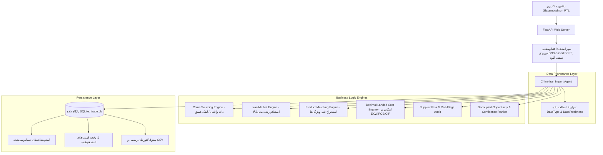

# برنامه اجرایی، معماری سیستم و وضعیت مراحل (IMPLEMENTATION_PLAN.md)
**پروژه iTrade China - ارتقای جامع مهندسی، داده و امنیت**
**تاریخ بازنگری:** مارس ۲۰۲۶
**وضعیت پروژه:** کلیه ۱۴ مرحله دستور جامع با موفقیت پیاده‌سازی و آزمایش شدند (۳۴ تست قبول‌شده).

---

## ۱. جدول وضعیت پیشرفت و تحقق مراحل ۱۴گانه

| مرحله | شرح وظیفه | ماژول‌های درگیر | وضعیت | شواهد و دستاوردها |
| :---: | :--- | :--- | :---: | :--- |
| **۱** | ممیزی کامل معماری، منابع داده و کدها | تمامی ماژول‌ها و تست‌ها | **تکمیل‌شده** | تدوین سند `IMPLEMENTATION_AUDIT.md` و پاسخ مستند به ۶ سؤال کلیدی |
| **۲** | حذف نمایش گمراه‌کننده داده‌های ساختگی | `china_sourcing.py`, `iran_market.py` | **تکمیل‌شده** | حذف کامل توابع مولد فیک (`_generate_gadget_suppliers` و ضرایب فرضی)؛ اعمال پروتکل عدم کفایت داده |
| **۳** | قرارداد صراحت و استانداردسازی خروجی | `core/models.py` | **تکمیل‌شده** | پیاده‌سازی `DataType`, `DataFreshness`, `Incoterms`, `VerificationStatus` |
| **۴** | اتصال‌های زنده، اعتبارسنجی و فال‌بک‌ها | `connectors/` | **تکمیل‌شده** | اتصال زنده به Digikala API، لینک‌های عمیق ۹ سورس چین و ترب/ایمالز/باسلام، فال‌بک دستی و CSV |
| **۵** | ارتقای موتور تطبیق کالا و مغایرت‌ها | `core/matching.py`, `core/agent.py` | **تکمیل‌شده** | استخراج مشخصات فنی واقعی از عنوان و متادیتای کالاها؛ رفع باگ پاس دادن `{}` خالی |
| **۶** | بازنویسی ماشین‌حساب بهای تمام‌شده | `core/calculator.py`, `core/money.py` | **تکمیل‌شده** | محاسبات قطعی با `Decimal`، نسخه‌بندی احکام (`IR-CUSTOMS-1403-1404-V2`)، تفکیک هزینه‌های اینکوترمز |
| **۷** | شفاف‌سازی نرخ‌های ارز و حواله | `config.py`, `server.py` | **تکمیل‌شده** | برچسب‌گذاری دقیق منبع و تاریخ نرخ ارز و پشتیبانی از اعمال نرخ سفارشی |
| **۸** | رتبه‌بندی فرصت و تفکیک از کیفیت شواهد | `core/ranking.py`, `core/verification.py` | **تکمیل‌شده** | استقلال کامل `opportunity_score` از `confidence_score`؛ تنزل به صفر در صورت نبود داده |
| **۹** | پایدارسازی در SQLite و ثبت اسنپ‌شات | `core/db.py` | **تکمیل‌شده** | ذخیره خودکار در `itrade.db`، مایگریشن خودکار فیلدها، اسنپ‌شات‌های حسابرسی‌شده و سیستم ثبت هشدار |
| **۱۰** | ارتقای رابط کاربری و وب‌سرور | `server.py`, `static/index.html` | **تکمیل‌شده** | نمایش بنر عدم کفایت داده، فرم ثبت مظنه دستی چین (با اینکوترمز) و قیمت بازار ایران، رفع کرش null |
| **۱۱** | مصون‌سازی امنیتی ورودی‌ها و SSRF | `server.py` | **تکمیل‌شده** | دفاع SSRF عمیق با رزولوشن DNS و مسدودی رنج‌های خصوصی، محدودیت آپلود ۵MB و محافظت Traversal |
| **۱۲** | توسعه مجموعه آزمون‌های خودکار | `tests/` | **تکمیل‌شده** | ۳۴ تست پایتست (۱۰۰٪ پاس) شامل تست‌های محاسبات، اینکوترمز، تطبیق، امنیت SSRF و تفکیک تست‌های Live |
| **۱۳** | مستندسازی و تدوین گزارش‌های فنی | ریشه پروژه (`*.md`) | **تکمیل‌شده** | نگارش و به‌روزرسانی کامل کلیه ۸ سند مستنداتی الزامی و فایل `.env.example` |
| **۱۴** | تضمین نهایی، پاک‌سازی و گزارش اجرایی | پروژه و مخزن گیت | **تکمیل‌شده** | آماده‌سازی گزارش جامع فارسی در ۱۲ بخش استاندارد و هماهنگی کامل با مخزن |

---

## ۲. نمودار معماری تمیز (Clean Architecture) پس از ارتقا

