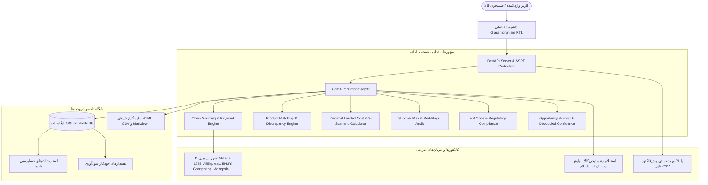

# 🇨🇳 ➡️ 🇮🇷 سامانه سازمانی آربیتراژ واردات چین و مرکز هوشمندی تجارت بین‌الملل
### iTrade Enterprise • Import Intelligence & Trade Intelligence Hub (v2.2)

[](https://www.python.org/downloads/)
[](https://fastapi.tiangolo.com)
[-success.svg)](TEST_REPORT.md)
[](LICENSE)
[](https://github.com/ho3einalik/chinatrade)

سامانه **iTrade Enterprise** یک پلتفرم جامع مهندسی، داده‌محور و تصمیم‌گیری تجاری برای **بازرگانان، شرکت‌های وارداتی، صادرکنندگان و کارآفرینان ایرانی** است. این پلتفرم از دو ماژول کاملاً مستقل و ایزوله تشکیل شده است:
1. **🇨🇳 ماژول واردات از چین (China Import Module):** سورسینگ تخصصی از کارخانه‌های چین، تطبیق مشخصات فنی، محاسبه بهای تمام‌شده گمرکی (Landed Cost)، مدل‌سازی سناریوهای سودآوری و ممیزی ریسک تأمین‌کنندگان.
2. **🌐 مرکز هوشمندی تجارت بین‌الملل (Trade Intelligence Hub):** تحلیل بازارهای جهانی با ITC Trade Map و UN Comtrade، کشف تقاضا (Demand Radar)، سورسینگ اولویت‌دار شبکه اختصاصی مخاطبان (My Trade Network CRM)، اعتبارسنجی شرکتی، ماشین‌حساب بهای تمام‌شده جهانی و مدیریت معاملات B2B.

> 🔒 **تضمین ۱۰۰٪ تفکیک فیزیکی و منطقی داده‌ها:** ماژول هوشمندی تجارت (`trade_hub.db`) از ماژول واردات چین (`itrade.db`) کاملاً ایزوله است. هیچ‌یک از جداول، مدل‌ها، یا درخواست‌های این دو ماژول بدون اقدام صریح کاربر با یکدیگر هم‌پوشانی یا تداخل ندارند (اثبات‌شده با آزمون‌های معماری در `tests/test_trade_hub_isolation.py`).

> 🔒 **اصل بنیادین شفافیت داده‌ها:** سامانه هیچ قیمت، تأمین‌کننده، نرخ ارز، کرایه حمل یا سودی را بدون منبع مشخص و معتبر، به‌عنوان داده واقعی نمایش نمی‌دهد. در صورت عدم دسترسی به داده قطعی، سیستم با شفافیت کامل وضعیت «اطلاعات ناکافی (Insufficient Data)» اعلام نموده و از محاسبات حدسی خودداری می‌کند.

---

## 📑 فهرست مطالب
1. [معماری سیستم و جریان داده](#-معماری-سیستم-و-جریان-داده)
2. [قابلیت‌های کلیدی نسخه ۲.۰](#-قابلیت‌های-کلیدی-نسخه-۲۰)
3. [پلتفرم‌های متصل و وضعیت سورس‌ها](#-پلتفرم‌های-متصل-و-وضعیت-سورس‌ها)
4. [متدولوژی مالی و محاسبات گمرکی](#-متدولوژی-مالی-و-محاسبات-گمرکی)
5. [راهنمای نصب و راه‌اندازی سریع](#-راهنمای-نصب-و-راه‌اندازی-سریع)
6. [مستندات مرجع پروژه](#-مستندات-مرجع-پروژه)
7. [آزمون‌های خودکار و تضمین کیفیت](#-آزمون‌های-خودکار-و-تضمین-کیفیت)
8. [امنیت و مصون‌سازی سامانه](#-امنیت-و-مصون‌سازی-سامانه)

---

## 🏛 معماری سیستم و جریان داده



---

## 🌟 قابلیت‌های کلیدی نسخه ۲.۰

### ۱. محاسبات مالی قطعی با Decimal (بدون خطای اعشاری)
- جایگزینی کامل متغیرهای `float` با کلاس `Decimal` در ماژول `core/money.py` با گردکردن استاندارد بانکی `ROUND_HALF_UP`.
- پیاده‌سازی متدهای آماری مقاوم (IQR Outlier Filtering و Trimmed Median) برای استخراج کف قیمت واقعی بازار و حذف داده‌های پرت.

### ۲. ماشین‌حساب جامع بهای تمام‌شده و مدل‌سازی ۳ سناریوی هم‌زمان
- **تفکیک ۱۳ سرفصل خطی هزینه:** خرید کالا، کارمزد صرافی و حواله ارزی، بازرسی کیفی مبدا (QC)، کرایه حمل هوایی/دریایی، بیمه باربری، حقوق ورودی گمرک، سود بازرگانی، مالیات بر ارزش افزوده ۱۰٪، ترخیص و کارگزاری، ذخیره انبارداری و دموراژ کانتینر، حمل داخلی مقصد، هزینه خواب سرمایه (بر مبنای سود سالانه ۲۴٪ در ایران)، و ذخیره ضایعات/خرابی.
- **۳ سناریوی تحلیلی:**
  - **واقع‌بینانه (Realistic):** بر مبنای نرخ‌های استاندارد روز بازار و ۳ ماه خواب سرمایه.
  - **خوش‌بینانه (Optimistic):** کاهش ۴٪ نرخ ارز، ترخیص سریع ۲ ماهه و افزایش ۵٪ قیمت فروش بازار.
  - **بدبینانه (Pessimistic):** جهش ۱۰٪ نرخ ارز، افزایش ۲۰٪ کرایه حمل، دموراژ مازاد و خواب سرمایه ۵ ماهه.
- **شاخص‌های کلیدی:** حاشیه سود ناخالص و خالص (Margin)، نرخ بازگشت سرمایه (ROI)، نقطه سر به سر قیمتی (Break-even Price) و حداقل تیراژ پوشش‌دهنده هزینه‌های ثابت (Break-even Units).
- نسخه‌بندی رسمی احکام گمرکی: `IR-CUSTOMS-1403-1404-V2`.

### ۳. موتور تطبیق هوشمند کالا (Product Matching Engine)
- استخراج ویژگی‌های فنی بر اساس دسته‌بندی کالا (مدل، توان الکتریکی، ولتاژ، ظرفیت باتری، گرید پتروشیمی مانند S-65 و خلوص مواد).
- طبقه‌بندی ۴گانه وضعیت تطبیق:
  - **تطبیق دقیق (EXACT):** انطباق کامل کد مدل و ویژگی‌ها (امتیاز بالای ۸۵).
  - **تطبیق نزدیک با تفاوت‌ها (CLOSE_WITH_DIFFERENCES):** انطباق عمومی با تفاوت در آپشن‌ها.
  - **تطبیق ضعیف (WEAK):** ناهمخوانی پارامترهای فنی اصلی.
  - **داده ناکافی (INSUFFICIENT_DATA):** فقدان مشخصات در عنوان‌ها.
- ارائه دلایل موافق، مغایرت‌ها و قابلیت تأیید تطبیق دستی توسط کاربر در داشبورد.

### ۴. تفکیک امتیاز جذابیت فرصت از سطح اطمینان داده‌ها
- جلوگیری از فریب سرمایه‌گذار در مواردی که سود محاسباتی بالاست اما اطمینان داده‌ها (به دلیل سورس ناقص یا عدم تطبیق دقیق) پایین است.
- امتیاز جذابیت فرصت (Opportunity Score از ۱۰) به صورت کاملاً مستقل از سطح اطمینان داده‌ها (Data Confidence از ۱۰۰٪) محاسبه و نمایش داده می‌شود.

### ۵. ممیزی ریسک و اعتبارسنجی تأمین‌کننده چین
- تشخیص ماهیت تولیدکننده صنعتی در برابر شرکت بازرگانی واسطه‌ای (Trading Company).
- کشف پرچم‌های قرمز تقلب (سابقه کمتر از ۱ سال، قیمت مشکوک زیر قیمت مواد اولیه، فقدان گواهی‌های استاندارد CE/RoHS).
- توصیه‌های الزام‌آور برای درج بند بازرسی شخص ثالث (Pre-shipment Inspection توسط SGS/Cotecna) قبل از تسویه حساب.

### ۶. مقررات گمرکی ایران و کدهای تعرفه (HS Code)
- پیشنهاد کدهای تعرفه منطبق بر کتاب مقررات صادرات و واردات سال جاری.
- اعلام مجوزهای الزامی: سازمان تنظیم مقررات و ارتباطات رادیویی (CRA) برای کالاهای وای‌فای/بلوتوث، سازمان ملی استاندارد (ISIRI)، و غذا و دارو (TTAC).
- برآورد زمان انتظار در صف تخصیص ارز نیما و سامانه جامع تجارت (NTSW).

### ۷. پایگاه داده، اسنپ‌شات‌های حسابرسی و هشدارهای قیمت
- ذخیره‌سازی خودکار در پایگاه داده SQLite (`itrade.db`) همراه با مایگریشن خودکار جداول.
- ذخیره اسنپ‌شات‌های حسابرسی‌شده برای هر جستجو و قابلیت بازخوانی تاریخچه.
- سامانه ثبت هشدار تغییرات قیمت و جهش سودآوری.

---

## 🌐 پلتفرم‌های متصل و وضعیت سورس‌ها

### تأمین‌کنندگان چین
| پلتفرم | حوزه تخصصی | وضعیت اتصال |
| :--- | :--- | :--- |
| **Alibaba.com (International B2B)** | بزرگ‌ترین پلتفرم بین‌المللی B2B عمده‌فروشی و قراردادهای کانتینری Trade Assurance | **زنده و فعال (لینک استعلام مستقیم)** |
| **1688.com (Alibaba Domestic)** | بزرگ‌ترین پلتفرم عمده‌فروشی داخلی چین با قیمت فاکتور داخلی (RMB) | **لینک عمیق استعلام مستقیم** |
| **AliExpress (خرید نمونه و تست بازار)** | سفارش نمونه تستی (Sample Orders)، اعتبارسنجی اولیه کالا و خرید با تیراژ خرد | **زنده و فعال (لینک استعلام مستقیم)** |
| **EHSY (西域)** | تجهیزات صنعتی، MRO کارخانه‌ای، ابزارآلات و اتوماسیون | **زنده و فعال (HTTP 200)** |
| **Gongchang (中国工厂网)** | دایرکتوری مستقیم کارخانه‌ها و تولیدی‌های OEM/ODM | **زنده و فعال (HTTP 200)** |
| **Makepolo (马可波罗)** | موتور جستجوی خریدهای عمده صنعتی و تدارکات B2B | **زنده و فعال (HTTP 200)** |
| **YiwuGo (义乌购)** | بازار بین‌المللی کالاهای سبک، خانگی و اسباب‌بازی ایوو | **زنده و فعال (HTTP 200)** |
| **Baidu Aicai (百度爱采购)** | پلتفرم تجاری رسمی موتور جستجوی بایدو | **زنده و فعال (HTTP 200)** |
| **ChemNet (中国化工网)** | پتروشیمی، پلیمرها، رزین‌ها و مواد شیمیایی دارویی | **زنده و فعال (HTTP 200)** |
| **QiPeiRen (汽配人)** | قطعات یدکی خودرو و ماشین‌آلات سنگین | **مسدود از IP خارجی (لینک دستی)** |
| **Nala (نالا)** | محصولات آرایشی و زیبایی | **سرور وب غیرفعال (جایگزین با 1688)** |

### بازار و رقبای ایران
- **دیجی‌کالا (Digikala):** استعلام زنده Real-time با فیلتر موجودی و محاسبه میانگین پیراسته.
- **ترب (Torob):** استعلام و مقایسه قیمت در بیش از ۱۰,۰۰۰ فروشگاه اینترنتی ایران.
- **ایمالز (Emalls):** پایش قیمت گارانتی‌های رسمی کالاهای دیجیتال.
- **باسلام (Basalam):** استعلام نرخ‌های بنکداران و واردکنندگان دست‌اول.
- **دیوار / شیپور (Divar/Sheypoor):** پایش کف قیمت نقد معامله دست‌اول در بازار آزاد.

---

## 📐 متدولوژی مالی و محاسبات گمرکی

فرمول‌های اصلی محاسبات بهای تمام‌شده و سودآوری در ماژول `core/calculator.py`:

- **وزن حجمی هوایی (IATA):**
  $$\text{Volumetric Weight (kg)} = \frac{L(\text{cm}) \times W(\text{cm}) \times H(\text{cm})}{5000}$$
- **کرایه حمل هوایی:**
  $$\text{Air Freight} = \max(\text{Actual Weight}, \text{Volumetric Weight}) \times \text{Rate (USD/kg)} \times \text{USD Rate}$$
- **ارزش CIF گمرک ایران:**
  $$\text{CIF} = \text{Purchase Cost} + \text{Freight} + \text{Insurance (0.5\%)}$$
- **مالیات بر ارزش افزوده (۱۰٪):**
  $$\text{VAT} = (\text{CIF} + \text{Customs Duty} + \text{Commercial Benefit}) \times 10\%$$
- **بهای تمام‌شده نهایی در انبار ایران (Landed Cost):**
  $$\text{Total Landed Cost} = \text{Direct Landed Subtotal} + \text{Financing Cost} + \text{Scrap Reserve}$$
- **حداقل قیمت فروش بدون ضرر (Break-Even):**
  $$\text{Break-Even Price} = \frac{\text{Total Landed Cost}}{1 - \text{Marketplace Commission}\%}$$

---

## 🚀 راهنمای نصب و راه‌اندازی سریع

### پیش‌نیازها
- پایتون نسخه ۳.۱۱ یا بالاتر
- سیستم‌عامل ویندوز، لینوکس یا مک

### ۱. کلون کردن ریپازیتوری
```bash
git clone https://github.com/ho3einalik/chinatrade.git
cd chinatrade
```

### ۲. نصب وابستگی‌ها
```bash
pip install -r requirements.txt
```

### ۳. تنظیم متغیرهای محیطی
فایل نمونه تنظیمات را کپی کرده و در صورت تمایل نرخ‌های ارز دلخواه خود را ویرایش کنید:
```bash
cp .env.example .env
```

### ۴. اجرای وب‌سرور مدرن (FastAPI)
```bash
python server.py
```
سپس مرورگر خود را باز کرده و به آدرس زیر بروید:
👉 **[http://localhost:8000](http://localhost:8000)**

### ۵. اجرای ابزار خط فرمان (CLI)
```bash
# تحلیل جامع یک کالا
python cli.py analyze "ساعت هوشمند"

# شکار فرصت‌های وارداتی در یک دسته‌بندی
python cli.py scan "گجت‌ها و الکترونیک مصرفی"
```

---

## 📚 مستندات مرجع پروژه

کلیه مستندات فنی، معماری، امنیتی و آماری پروژه در قالب فایل‌های مجزا در مخزن نگهداری می‌شوند:

| نام سند | توضیحات |
| :--- | :--- |
| 📖 [IMPLEMENTATION_AUDIT.md](IMPLEMENTATION_AUDIT.md) | ممیزی خط مبنا، طبقه‌بندی قطعات و وضعیت اولیه ماژول‌ها |
| 🗺️ [IMPLEMENTATION_PLAN.md](IMPLEMENTATION_PLAN.md) | نقشه راه معماری، فازبندی اجرا و مدیریت ریسک‌های فنی |
| 🌐 [DATA_SOURCES.md](DATA_SOURCES.md) | وضعیت دسترسی زنده، پروتکل‌ها و محدودیت‌های سورس‌های چین و ایران |
| 🧮 [CALCULATION_METHODOLOGY.md](CALCULATION_METHODOLOGY.md) | مستندات کامل ریاضی، فرمول‌های حسابداری صنعتی و سناریوهای ۳گانه |
| 🧪 [TEST_REPORT.md](TEST_REPORT.md) | ماتریس ۲۸ آزمون خودکار پاس‌شده و لاگ‌های اثبات صحت عملکرد |
| 🔒 [SECURITY_REVIEW.md](SECURITY_REVIEW.md) | ممیزی امنیت، محافظت در برابر حملات SSRF و Path Traversal |
| 🌐 [TRADE_INTELLIGENCE_SPEC.md](TRADE_INTELLIGENCE_SPEC.md) | سند جامع مشخصات نیازمندی‌های مرکز هوشمندی تجارت |
| 🏛 [TRADE_INTELLIGENCE_ARCHITECTURE.md](TRADE_INTELLIGENCE_ARCHITECTURE.md) | معماری تفکیک ماژولار و پروتکل ایزولاسیون دیتابیس |
| 📊 [TRADE_DATA_SOURCES.md](TRADE_DATA_SOURCES.md) | ماتریس ۷ پایگاه داده تجارت جهانی و قراردادهای آداپتور |
| 🛡 [TRADE_SECURITY.md](TRADE_SECURITY.md) | مدل تهدیدات امنیتی، دفاع در برابر تزریق فرمول CSV و Multi-Tenancy |
| 📈 [TRADE_DATA_QUALITY.md](TRADE_DATA_QUALITY.md) | سطوح اطمینان شواهد آماری و مدل داده استاندارد |
| 📋 [TRADE_IMPLEMENTATION_PLAN.md](TRADE_IMPLEMENTATION_PLAN.md) | برنامه فازبندی‌شده ۱۲ مرحله‌ای و گیت‌های کنترل کیفی |
| 📝 [CHANGELOG.md](CHANGELOG.md) | تاریخچه تفصیلی تغییرات نسخه ۲.۰ سازمانی |
| ⚙️ [.env.example](.env.example) | قالب ایمن و مستند متغیرهای پیکربندی سامانه |

---

## 🌐 مرکز هوشمندی تجارت بین‌الملل (Trade Intelligence Hub)

این ماژول سازمانی در کنار واردات چین، قابلیت‌های زیر را به صورت کاملاً ایزوله در اختیار تجار قرار می‌دهد:
1. **مسیر ۱: محصولی برای فروش دارم (صادرات):** کشف خودکار کدهای تعرفه HS، تعیین مقاصد برتر وارداتی، نرخ رشد بازار، موانع تعرفه‌ای و نگارش پیش‌نویس رسمی پیشنهاد فروش به دو زبان فارسی و انگلیسی.
2. **مسیر ۲: به محصولی نیاز دارم (سورسینگ):** جستجوی اولویت‌دار در شبکه مخاطبان اختصاصی کاربر، ممیزی اعتبار کارخانه و محاسبه بهای تمام‌شده تحویل در مقصد.
3. **مسیر ۳: کشف تقاضا و رادار فرصت (Demand Radar):** پایش فرصت‌های با رشد بالا در بخش‌های پتروشیمی، مصالح ساختمانی، صنایع غذایی و فلزات بدون نیاز به ورود نام کالا.
4. **شبکه اختصاصی من (My Trade Network CRM):** پایگاه داده محرمانه شرکای تجاری، با اولویت جستجو، اعتبارسنجی هویتی و محافظت کامل در برابر حملات CSV Formula Injection.
5. **پایپ‌لاین استعلام و معاملات (RFQs & Deals):** مدیریت چرخه عمر استعلام‌ها و تبدیل با یک کلیک به معاملات فعال CRM با محاسبه ارزش وزنی و پیش‌بینی سود.
6. **ماشین‌حساب بهای تمام‌شده جهانی:** محاسبه دقیق با Decimal برای هر مبدا و مقصد دلخواه، پوشش کلیه ترم‌های اینکوترمز ۲۰۲۰ و تحلیل حساسیت نوسان ۱۰٪ ارز و ۲۰٪ کرایه حمل.
7. **کاوشگر Trade Map و منابع تجاری:** یکپارچه‌سازی ۷ منبع داده (ITC Trade Map, UN Comtrade, Market Access Map, Export Potential Map, سازمان توسعه تجارت ایران، اتاق مشترک ایران و عراق، پارس‌گودز) همراه با پارسر فایل اکسپورت Trade Map.

---

## 🧪 آزمون‌های خودکار و تضمین کیفیت

سامانه مجهز به **۶۱ آزمون خودکار (۱۰۰٪ پاس‌شده)** در پوشه `tests/` است:
- **بخش واردات چین (۳۴ آزمون):**
  - `tests/test_money.py`: آزمون‌های محاسبات مالی، کلاس `Money`، نرخ تبدیل و حذف داده‌های پرت.
  - `tests/test_calculator.py`: آزمون‌های وزن حجمی، سناریوهای ۳گانه و سرفصل‌های ۱۳گانه هزینه.
  - `tests/test_matching.py`: آزمون‌های تطبیق گرید پتروشیمی، ابزار صنعتی و خطاهای مدل.
  - `tests/test_connectors.py`: آزمون‌های قطع مدار (CircuitBreaker)، تولید لینک‌ها و پارسر CSV.
  - `tests/test_ranking.py`: آزمون‌های تفکیک اطمینان داده از جذابیت، کشف پرچم‌های قرمز تقلب و CRA.
  - `tests/test_e2e.py`: آزمون‌های یکپارچگی وب‌سرور، مسدودسازی SSRF و دانلود گزارش‌ها.
  - `tests/test_live_sources.py`: آزمون‌های استعلام زنده و بررسی سلامت منابع.
- **بخش مرکز هوشمندی تجارت (۲۷ آزمون):**
  - `tests/test_trade_hub_isolation.py`: **آزمون بنیادین ایزولاسیون کامل معماری** (اثبات عدم تداخل فیزیکی `trade_hub.db` و `itrade.db`).
  - `tests/test_trade_hub_models.py`: آزمون‌های مدل‌های Pydantic v2، فیلدهای Decimal و اینکوترمز.
  - `tests/test_trade_hub_network.py`: آزمون‌های پایگاه CRM، رفع تکراری‌ها و دفاع در برابر تزریق فرمول CSV.
  - `tests/test_trade_hub_calculator.py`: آزمون‌های محاسبات چندمسیره، سرفصل‌های خطی و تحلیل حساسیت.
  - `tests/test_trade_hub_journeys.py`: آزمون‌های مسیرهای سه‌گانه فروشنده، خریدار و رادار کشف فرصت.
  - `tests/test_trade_hub_rfq_deal.py`: آزمون‌های ماشین وضعیت استعلام و پایپ‌لاین معاملات CRM.
  - `tests/test_trade_hub_api.py`: آزمون‌های یکپارچگی اندپوینت‌های FastAPI ماژول Trade Hub.

برای اجرای کلیه آزمون‌ها:
```bash
pytest
```

---

## 🔒 امنیت و مصون‌سازی سامانه

- **تفکیک فیزیکی و منطقی داده‌ها:** پایگاه داده `trade_hub.db` به صورت مستقل از `itrade.db` نگهداری می‌شود تا خطر نشت یا تداخل داده‌ها به صفر برسد.
- **محافظت در برابر تزریق فرمول‌های CSV (CSV Formula Injection):** خنثی‌سازی خودکار کاراکترهای خطرناک پیشرو (`=`, `+`, `-`, `@`, `\t`, `\r`) در زمان ایمپورت مخاطبان شبکه.
- **محافظت عمیق در برابر SSRF (با رزولوشن DNS):** کنترل دقیق تمام ورودی‌های کاربر و مسدودسازی دسترسی به آدرس‌های لوپ‌بک، شبکه خصوصی و متادیتای ابری.
- **جلوگیری از Directory Traversal:** پاک‌سازی و اعتبارسنجی نام فایل‌ها با `os.path.basename` در دانلود گزارش‌ها.
- **تزریق SQL:** استفاده انحصاری از کوئری‌های پارامتری‌شده در ارتباط با کلیه دیتابیس‌ها.

---

## 🤝 مشارکت و پشتیبانی
این پروژه با هدف شفاف‌سازی و هوشمندسازی واردات برای تولیدکنندگان و بازرگانان ایرانی توسعه یافته است. در صورت تمایل به مشارکت، لطفاً Pull Request ارسال فرمایید یا در بخش Issues نظرات خود را مطرح کنید.
