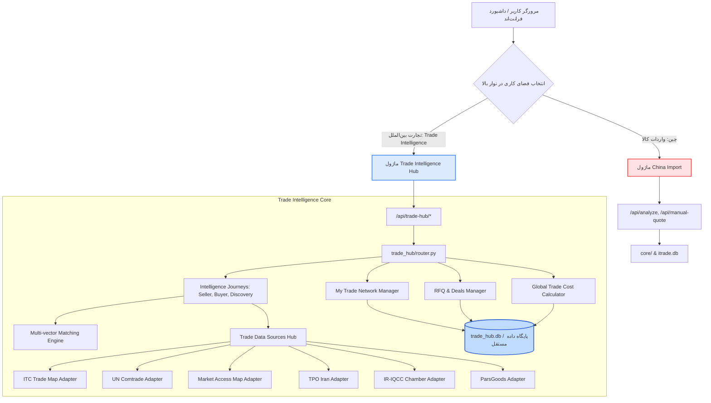

# سند معماری نرم‌افزار و جریان داده (TRADE_INTELLIGENCE_ARCHITECTURE.md)
**پروژه:** Trade Intelligence Hub • مرکز هوشمندی تجارت بین‌الملل  
**معماری:** Clean Architecture با تفکیک ماژولار کامل (Modular Isolation Pattern)  
**نسخه:** 1.0.0 | **تاریخ:** مارس ۲۰۲۶  

---

## ۱. ساختار لایه‌بندی و مرزهای ماژولار

برای تضمین عدم تداخل با ماژول واردات چین و حفظ ساختار تمیز، تمام قابلیت‌های مرکز هوشمندی تجارت در پکیج مستقل `trade_hub/` پیاده‌سازی می‌شوند:

```
import/
├── core/                              # ماژول مستقل واردات چین (دست‌نخورده و بدون تغییر)
├── connectors/                        # کانکتورهای چین و بازار ایران (دیجی‌کالا و B2B چین)
├── trade_hub/                         # پکیج جدید و مستقل مرکز هوشمندی تجارت
│   ├── __init__.py
│   ├── models.py                      # تعاریف دامنه‌ای و Pydantic v2 مستقل Trade Hub
│   ├── db.py                          # پایگاه داده مستقل SQLite (trade_hub.db) با عایق‌بندی کامل
│   ├── sources/                       # آداپتورهای مستقل منابع داده تجاری
│   │   ├── __init__.py
│   │   ├── base.py                    # کلاس پایه و قرارداد مشترک منبع (SourceAdapter)
│   │   ├── trademap.py                # آداپتور رسمی ITC Trade Map
│   │   ├── comtrade.py                # آداپتور UN Comtrade
│   │   ├── macmap.py                  # آداپتور Market Access Map (تعرفه و موانع فنی)
│   │   ├── export_potential.py        # آداپتور ITC Export Potential Map
│   │   ├── tpo_iran.py                # آداپتور سازمان توسعه تجارت ایران (TPO)
│   │   ├── iriqcc.py                  # آداپتور اتاق مشترک ایران و عراق
│   │   └── parsgoods.py               # آداپتور پایگاه صادراتی ParsGoods
│   ├── network/                       # شبکه اختصاصی بازرگان (My Trade Network)
│   │   ├── __init__.py
│   │   ├── repository.py              # مدیریت مخاطبین، خریداران و تأمین‌کنندگان خصوصی
│   │   └── importer.py                # ایمپورتر و اعتبارسنجی فایل‌های CSV و Excel
│   ├── matching/                      # موتور تطبیق چندبُعدی و قابل توضیح
│   │   ├── __init__.py
│   │   └── engine.py                  # ارزیابی ابعاد ۶گانه (فنی، تجاری، لجستیکی، مقرراتی، اطمینان، تازگی)
│   ├── operations/                    # مدیریت عملیات و اسناد تجاری
│   │   ├── __init__.py
│   │   ├── rfq_manager.py             # چرخه حیات استعلام‌ها، درخواست‌ها و مظنه‌ها
│   │   ├── deal_manager.py            # CRM معاملات و خط لوله پیگیری
│   │   └── cost_calculator.py         # ماشین‌حساب جامع و مستقل بهای تمام‌شده تجارت جهانی
│   ├── intelligence/                  # سرویس‌های تحلیل هوشمند و سفرهای ۳گانه کاربر
│   │   ├── __init__.py
│   │   ├── journey_seller.py          # مسیر اول: «محصولی برای فروش دارم»
│   │   ├── journey_buyer.py           # مسیر دوم: «به محصولی نیاز دارم»
│   │   ├── journey_discovery.py       # مسیر سوم: «کشف فرصت‌های تجاری و Demand Radar»
│   │   ├── market_report.py           # تولید شناسنامه جامع و تحلیل بازار
│   │   ├── company_verification.py    # ممیزی و ارزیابی ریسک شرکت‌ها
│   │   └── ai_assistant.py            # دستیار هوشمند تدوین مکاتبات و پیش‌نویس RFQ
│   └── router.py                      # روتر مجزای FastAPI با پیشوند /api/trade-hub
├── server.py                          # وب‌سرور یکپارچه (مونت‌کننده هر دو روتر ماژولار)
├── static/
│   └── index.html                     # رابط کاربری با سوییچ کاربری بین دو فضای کاری
└── tests/
    ├── test_trade_hub_models.py       # تست‌های مدلی و اعتبارسنجی فیلدها
    ├── test_trade_hub_sources.py      # تست‌های آداپتورهای منابع داده
    ├── test_trade_hub_network.py      # تست‌های شبکه خصوصی و فایل‌ها
    ├── test_trade_hub_matching.py     # تست‌های موتور تطبیق قابل توضیح
    ├── test_trade_hub_calculator.py   # تست‌های ماشین‌حساب بهای تمام‌شده جهانی
    ├── test_trade_hub_journeys.py     # تست‌های سفرهای سه‌گانه
    └── test_trade_hub_isolation.py    # تست اثبات عدم مخلوط شدن داده‌های چین و تجارت
```

---

## ۲. نمودار جریان داده و تفکیک دامنه‌ها (Data Flow & Domain Boundary)



---

## ۳. تضمین جداسازی داده‌ها (Data Isolation Protocol)

1. **فایل دیتابیس مجزا:**
   مرکز هوشمندی تجارت از فایل پایگاه داده اختصاصی `trade_hub.db` (یا در صورت تمایل جداول با پیشوند اکید `th_*` در دیتابیس تفکیک‌شده) استفاده می‌کند تا هیچ امکانی برای اجرای کوئری مشترک بدون فیلتر وجود نداشته باشد.
2. **پیشوند مسیرهای API:**
   تمام مسیرهای جدید زیرمجموعه `/api/trade-hub/` قرار می‌گیرند و مسیرهای موجود `/api/*` مربوط به واردات چین دست‌نخورده باقی می‌مانند.
3. **مستأجر و مالکیت داده (Ownership):**
   هر رکورد در شبکه خصوصی دارای `tenant_id` یا شناسه کاربر است و هیچ داده محرمانه‌ای به منابع بیرونی فاش نخواهد شد.
4. **تست خودکار ایزولاسیون (`test_trade_hub_isolation.py`):**
   تستی رسمی تعبیه می‌شود که اثبات کند عملیات ثبت تأمین‌کننده یا استعلام در Trade Hub هیچ تغییری در جداول واردات چین ایجاد نمی‌کند و بالعکس.
