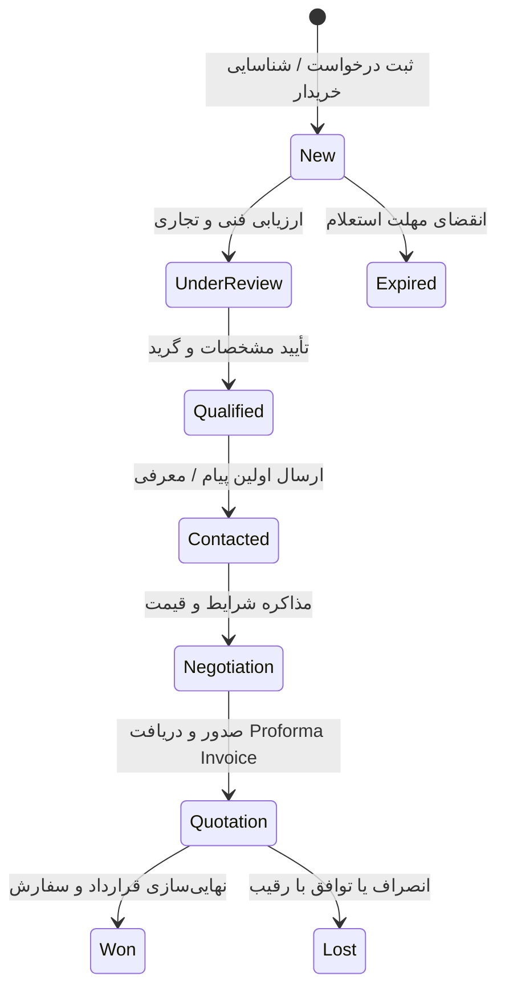

# مشخصات فنی و سند نیازمندی‌های مرکز هوشمندی تجارت (TRADE_INTELLIGENCE_SPEC.md)
**پروژه:** iTrade China & Global Trade Intelligence Hub  
**نسخه سند:** 1.0.0 | **تاریخ تصویب:** مارس ۲۰۲۶  
**معمار و طراح:** ارشد مهندسی نرم‌افزار، سیستم‌های تجارت بین‌الملل و طراحی محصول B2B  

---

## ۱. مأموریت و چشم‌انداز محصول

مرکز هوشمندی تجارت بین‌الملل (**Trade Intelligence Hub**) یک سیستم عملیاتی مستقل در پلتفرم iTrade است که بازرگانان، صادرکنندگان، واردکنندگان و تولیدکنندگان را قادر می‌سازد از مرحله **شناسایی فرصت‌های بازار جهانی** تا **یافتن طرف‌های تجاری (خریداران و تأمین‌کنندگان)**، **دریافت و مقایسه استعلام قیمت (RFQ)**، **محاسبه دقیق بهای تمام‌شده و سود معامله**، و **مدیریت فرآیند مذاکره و قرارداد** را در یک جریان کاری یکپارچه طی نمایند.

> ⚠️ **اصل بنیادین معماری (Non-Negotiable Separation):**  
> این ماژول کاملاً مستقل از ماژول فعلی واردات از چین است. پایگاه‌های داده، مسیرهای API، سرویس‌های تحلیلی، شبکه‌های شرکای تجاری و گزارش‌های این دو بخش به هیچ وجه بدون دستور و اقدام آگاهانه کاربر مخلوط نخواهند شد.

---

## ۲. سه مسیر اصلی سفر کاربر (The 3 Core User Journeys)

### ۲.۱. مسیر اول: «من محصولی برای فروش دارم» (Seller / Export Journey)
کاربر محصولی تولیدی یا تجاری در اختیار دارد و به دنبال یافتن بازارهای هدف صادراتی، خریداران فعال و مدل‌سازی سودآوری صادرات است:
1. **ورود اطلاعات کالا:** نام فارسی و انگلیسی، مشخصات فنی، گرید کیفی، استانداردهای احراز شده، ظرفیت تأمین ماهانه/سالانه و کد HS احتمالی.
2. **کشف و اعتبارسنجی HS Code:** پیشنهاد کدهای ۶ و ۸ رقمی کتاب تعرفه با امتیاز اطمینان و مستندات قانونی در صورت نامشخص بودن.
3. **تحلیل بازارهای واردکننده جهانی:** استخراج کشورهای دارای بیشترین تقاضا، روند رشد واردات ۳ تا ۵ سال گذشته، تفکیک رشد ارزشی از رشدی حجمی.
4. **تحلیل رقبای بین‌المللی:** سهم بازار کشورهای صادرکننده رقیب، روند قیمتی واحد (Unit Value) و شناسایی فرصت‌های ورود به بازار.
5. **موانع تجاری و تعرفه‌ای:** شناسایی نرخ حقوق ورودی، موانع فنی تجارت (TBT) و استانداردهای بهداشتی (SPS) در بازار هدف.
6. **شناسایی خریداران بالقوه:** جستجو در شبکه اختصاصی کاربر (My Trade Network) و منابع مجاز بین‌المللی با نمایش دقیق منبع، تاریخ و اطلاعات تماس.
7. **محاسبه هزینه‌های صادرات:** محاسبه قیمت فوب یا سیف بر مبنای اینکوترمز، کرایه حمل، بیمه، عوارض صادراتی و سود خالص تقریبی.
8. **ابزارهای تعامل B2B:** تولید خودکار پیش‌نویس مکاتبه تجاری، ایمیل معرفی محصول و پیشنهاد فروش (Sales Offer).
9. **خروجی:** «شناسنامه عملیاتی ورود به بازار صادراتی» (Market Entry Dossier).

### ۲.۲. مسیر دوم: «من به یک محصول نیاز دارم» (Buyer / Sourcing Journey)
کاربر به دنبال خرید یا واردات کالا یا ماده اولیه از سراسر دنیاست:
1. **ثبت نیاز تجاری:** نام کالا، استاندارد، گرید، تناژ یا تیراژ مورد نیاز، کشور ترجیحی مبدأ و مقصد تحویل.
2. **جستجوی اولویت‌دار در شبکه خصوصی:** تطبیق اولیه تقاضا با تأمین‌کنندگان ثبت‌شده در شبکه اختصاصی کاربر پیش از جستجوی منابع ناشناس خارجی.
3. **جستجو در دایرکتوری‌های مجاز تجاری:** استخراج تأمین‌کنندگان بالقوه از منابع معتبر با ثبت منبع و تاریخ بررسی.
4. **تطبیق فنی و رتبه‌بندی تأمین‌کنندگان:** ارزیابی انطباق گرید، حداقل مقدار سفارش (MOQ)، زمان تولید (Lead Time)، و شرایط پرداخت.
5. **محاسبه هزینه تمام‌شده در مقصد:** مدل‌سازی بهای تمام‌شده Landed Cost با اینکوترمز انتخابی.
6. **مدیریت استعلام قیمت (RFQ Engine):** صدور درخواست رسمی مظنه، مقایسه پیشنهادهای دریافتی، ثبت پیش‌فاکتور و آغاز مذاکره.

### ۲.۳. مسیر سوم: «هنوز نمی‌دانم چه محصولی معامله کنم» (Opportunity Discovery / Demand Radar)
کاربری که سرمایه تجاری در اختیار دارد و می‌خواهد فرصت‌های بالقوه سودآور در بازارهای جهانی را کشف کند:
1. **رادار تقاضای بازار (Market Demand Radar):** پایش کالاهای دارای نرخ رشد وارداتی مثبت در بازارهای منطقه‌ای و جهانی.
2. **تحلیل پتانسیل صادراتی:** کشف شکاف عرضه (Export Potential Gap) بین ظرفیت صادراتی کشورها و تقاضای مقصد.
3. **تفکیک ارزش از حجم:** تفکیک رشد ناشی از افزایش تقاضای فیزیکی از رشد ناشی از تورم جهانی قیمت کالاها.
4. **فیلترهای سفارشی:** غربالگری بر اساس سرمایه اولیه مورد نیاز، سطح ریسک ارزی و حمل، و نوع معامله.
5. **شناسایی درخواست‌های خرید فعال (Buyer Leads):** نمایش درخواست‌های خرید رسمی منتشر شده با تفکیک تاریخ انقضا.
6. **خروجی:** گزارش فرصت تجاری با تحلیل رقبا، هزینه‌های احتمالی و گام‌های بعدی پیشنهادی.

---

## ۳. معماری منابع داده و الزامات شفافیت

### ۳.۱. ماتریس سورس‌های داده
1. **ITC Trade Map (`trademap.org`):** جریان‌های تجارت بین‌الملل، روند واردات و صادرات، ارزش، حجم و سهم بازار بر مبنای داده‌های UN Comtrade.
2. **ITC Market Access Map (`macmap.org`):** اطلاعات تعرفه‌ای، ترجیحات تجاری، موافقت‌نامه‌های دوجانبه و موانع فنی.
3. **ITC Export Potential Map (`exportpotential.intracen.org`):** پیش‌بینی پتانسیل صادرات و شکاف‌های کشف‌نشده تجارت.
4. **سازمان توسعه تجارت ایران (TPO `tpo.ir`):** آمار تجارت خارجی ایران، مقررات صادرات، موافقت‌نامه‌ها و اطلاعیه‌های رسمی.
5. **اتاق مشترک بازرگانی ایران و عراق (`ir-iqcc.com`):** پایانه‌های مرزی، مقررات استاندارد و فهرست شرکت‌های فعال در تجارت با عراق.
6. **پارس گودز (ParsGoods `parsgoods.com`):** دایرکتوری و کاتالوگ کالاهای صادرکنندگان ایرانی.
7. **سازمان ملل (UN Comtrade `comtradeplus.un.org`):** داده‌های مرجع گمرکی کشورها.

### ۳.۲. قانون عدم جعل داده (Zero Fabrication Policy)
- در صورت نبود دسترسی به API زنده یا وجود سیستم‌های محافظت از اشتراک، سیستم باید امکان بارگذاری فایل‌های قانونی Excel/CSV و لینک‌های مستقیم جستجو را ارائه دهد.
- هر رکورد تجاری باید دارای متادیتای ردیابی شامل: `source_name`، `source_url`، `retrieved_at`، `data_period`، `evidence_type` و `confidence_level` باشد.
- آمار کلان یک کشور به هیچ عنوان به عنوان سفارش قطعی یک شرکت معین معرفی نخواهد شد.

---

## ۴. ماژول شبکه اختصاصی بازرگان (My Trade Network)
مدیریت ارتباطات تجاری محرمانه کاربر به منظور نگهداری اطلاعات خریداران، تأمین‌کنندگان، سوابق مذاکره و پیش‌فاکتورها با قابلیت ورود دستی، ورود دسته‌ای CSV/Excel و حذف موارد تکراری. این داده‌ها محرمانه بوده و هرگز به منابع خارجی ارسال نمی‌شوند.

---

## ۵. ماتریس وضعیت گردش کار اسناد و معاملات (Deal & RFQ Lifecycle)

---

## ۶. معیارهای پذیرش سیستم (Acceptance Criteria)
1. تفکیک کامل ۱۰۰ درصدی داده‌ها بین ماژول واردات چین و Trade Intelligence Hub که توسط تست‌های خودکار اثبات شود.
2. اجرای بدون نقص هر سه مسیر کاربر (فروشنده، خریدار، کشف فرصت).
3. محاسبات مالی و گمرکی بر مبنای `Decimal` با امکان انتخاب ارزها و اینکوترمز.
4. پشتیبانی از ورود داده از فایل‌های CSV/Excel برای Trade Map و مخاطبین تجاری.
5. رابط کاربری واکنش‌گرا و راست‌چین با سوییچ کاربری بین دو ماژول.
6. حفظ پایداری کامل کلیه ۳۴ تست قبلی مربوط به واردات چین.
